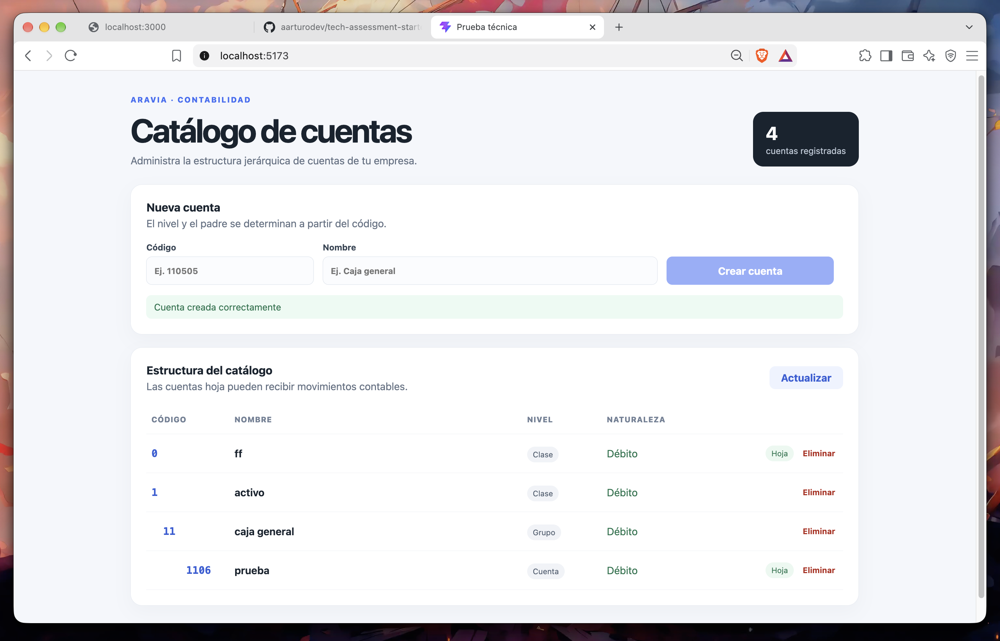
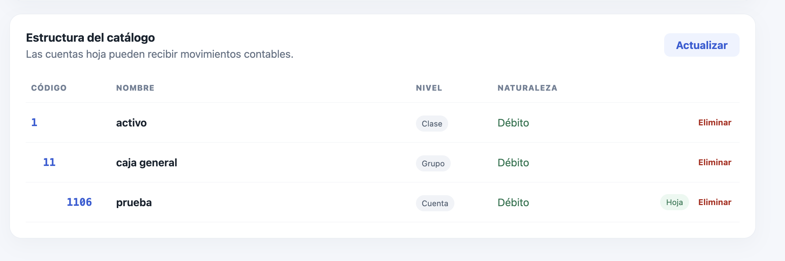
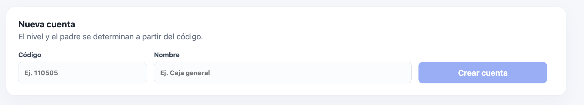
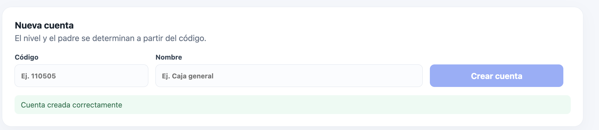

# Aravia - Catálogo de cuentas

Módulo full-stack para administrar el catálogo jerárquico de cuentas de una empresa.


## Descripción

El sistema permite crear, consultar y eliminar cuentas contables respetando las reglas del catálogo:

- Las clases tienen códigos de 1 dígito.
- Los grupos tienen códigos de 2 dígitos.
- Las cuentas tienen códigos de 4 dígitos.
- Las subcuentas tienen códigos de 6 dígitos.
- Una cuenta no puede crearse si su padre no existe.
- El código debe ser único.
- La naturaleza débito/crédito se hereda desde la clase.
- No se puede eliminar una cuenta que tenga hijos.
- Solo las cuentas hoja pueden recibir movimientos contables.

## Funcionalidades implementadas

### Backend

- API REST desarrollada con NestJS y TypeScript.
- Arquitectura basada en:
  - Entidades de dominio.
  - DTOs.
  - Casos de uso.
  - Repositorio.
  - Controlador.
- Persistencia temporal en memoria.
- Validación de códigos, nombres, padres y naturaleza.
- Creación unificada mediante `POST /cuenta`.
- Consulta del catálogo completo.
- Consulta de una cuenta por código.
- Eliminación de cuentas hoja.
- Respuestas HTTP con errores descriptivos.
- Pruebas unitarias de las reglas principales.

### Frontend

- Interfaz desarrollada con React, TypeScript y Vite.
- Formulario para crear cuentas.
- Selección de naturaleza para las clases.
- Visualización jerárquica del catálogo.
- Identificación de cuentas hoja.
- Eliminación de cuentas.
- Mensajes de éxito y error.
- Diseño responsive básico.

## Arquitectura

```text
api/src/cuenta
├── application
│   └── use-cases
├── domain
│   ├── dto
│   ├── entities
│   ├── errors
│   └── repositories
├── infrastruture
│   └── repositories
├── cuenta.controller.ts
└── cuenta.module.ts
```

El frontend consume la API mediante funciones centralizadas en:

```text
web/src/api.ts
```

## Endpoints principales

| Método   | Endpoint          | Descripción                               |
| -------- | ----------------- | ----------------------------------------- |
| `GET`    | `/cuenta`         | Lista todas las cuentas                   |
| `GET`    | `/cuenta/:codigo` | Consulta una cuenta                       |
| `POST`   | `/cuenta`         | Crea una clase, grupo, cuenta o subcuenta |
| `DELETE` | `/cuenta/:codigo` | Elimina una cuenta sin hijos              |

### Ejemplo de creación de una clase

```json
{
  "codigo": "1",
  "nombre": "Activo",
  "naturaleza": "débito"
}
```

### Ejemplo de creación de una subcuenta

```json
{
  "codigo": "110505",
  "nombre": "Caja general"
}
```

## Imágenes del proyecto

> Reemplazar los siguientes espacios por capturas reales de la aplicación.

### Catálogo de cuentas

<!-- Insertar aquí una imagen del catálogo -->



### Formulario de creación

<!-- Insertar aquí una imagen del formulario -->



### Validación o mensaje de error

<!-- Insertar aquí una imagen de validaciones -->



## Requisitos

- Node.js 22.
- npm 10 o superior.

## Instalación y ejecución

Desde la raíz del proyecto:

```bash
npm install
npm run dev
```

Aplicaciones disponibles en:

- Frontend: http://localhost:5173
- API: http://localhost:3000

También pueden ejecutarse por separado:

```bash
npm run dev:api
npm run dev:web
```

## Pruebas y validaciones

Backend:

```bash
cd api
npm test
npm run build
npm run lint
```

Frontend:

```bash
cd web
npm run build
npm run lint
```

Las pruebas actuales cubren:

- Creación de la jerarquía.
- Herencia de naturaleza.
- Validación de padre inexistente.
- Rechazo de códigos duplicados.
- Restricción de eliminación de cuentas con hijos.
- Eliminación de cuentas hoja.

## Decisiones y limitaciones actuales

- Se utilizó un repositorio en memoria para mantener el alcance de la prueba y evitar configuración adicional de base de datos.
- El catálogo se reinicia cuando se reinicia la API.
- Los movimientos contables no se almacenan todavía; únicamente se informa si una cuenta puede recibirlos.
- El frontend es intencionalmente básico y está enfocado en demostrar el flujo principal.

## Mejoras posibles con más tiempo

- Incorporar una base de datos real con migraciones.
- Agregar persistencia por empresa o compañía.
- Implementar autenticación y autorización.
- Agregar edición de nombres y metadatos de cuentas.
- Incorporar movimientos contables reales y validar que solo se registren en cuentas hoja.
- Añadir paginación, búsqueda y filtros.
- Mejorar la visualización del árbol con expansión y colapsado de nodos.
- Agregar pruebas e2e completas para todos los endpoints.
- Incorporar documentación OpenAPI/Swagger.
- Mejorar accesibilidad y agregar pruebas visuales.
- Añadir manejo de concurrencia y restricciones de unicidad a nivel de base de datos.
- Crear un sistema de auditoría para registrar cambios en el catálogo.

## Uso de inteligencia artificial

La implementación se completó utilizando IA como apoyo durante el desarrollo. Se utilizó para revisar la estructura inicial, identificar errores, proponer la arquitectura, implementar las reglas de negocio, crear pruebas, construir la interfaz y revisar los resultados de compilación y lint.

Al finalizar, se logró completar la funcionalidad solicitada del proyecto, incluyendo backend, frontend básico, validaciones y pruebas.
